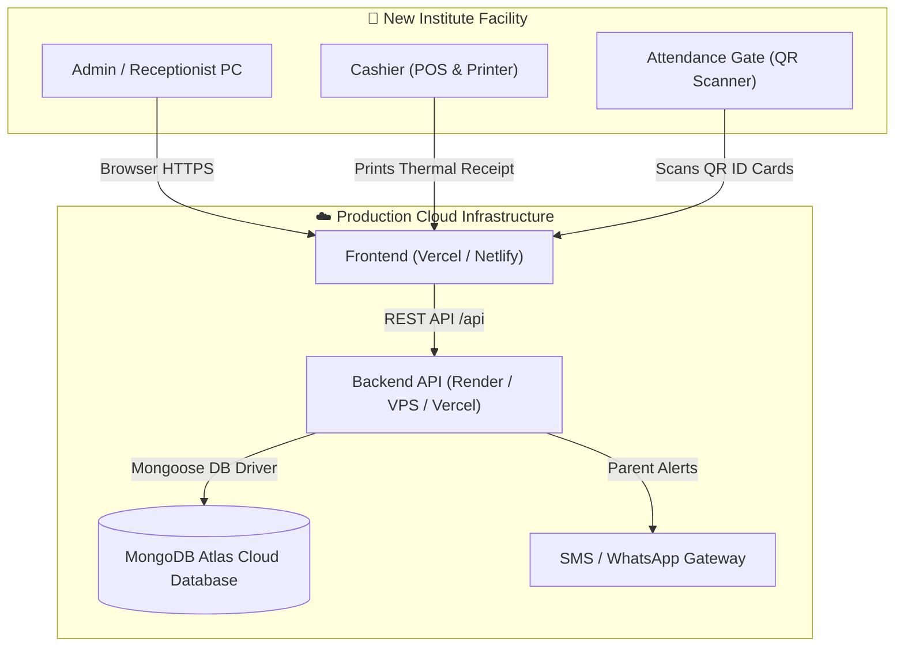
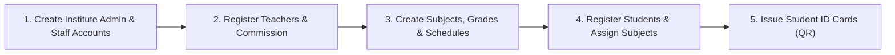

# 🏛️ Eduflex Institute Management System — Implementation Plan & Rollout Guide

A complete, production-ready implementation and deployment roadmap for white-labeling, configuring, and launching the Eduflex management system for a new educational institute.

---

## 📋 Executive Overview & Architecture

The Eduflex system is designed with a modern decoupled architecture:
- **Frontend**: React 19, Material-UI (MUI v7), Framer Motion, HTML5 QR Scanner / React-QR-Code, jsPDF (Receipts & ID Cards), i18n multi-language support.
- **Backend**: Node.js & Express 5 (REST API), Mongoose / MongoDB Atlas, JWT Authentication, Rate Limiting & Helmet Security.
- **Key Hardware Integrations**: USB/Bluetooth 2D QR Barcode Scanner, 58mm/80mm ESC/POS Thermal Receipt Printer, Webcam/Mobile Scanner.



---

## 🗓️ Implementation Roadmap (Phased Timeline)

| Phase | Milestone | Est. Duration | Ownership |
| :--- | :--- | :--- | :--- |
| **Phase 1** | Requirement Gathering & Asset Collection | Days 1 – 2 | Project Lead & Institute Admin |
| **Phase 2** | Codebase White-Labeling & Customization | Days 3 – 4 | Developer |
| **Phase 3** | Database Setup & Initial Seeding | Day 5 | Developer |
| **Phase 4** | Cloud Hosting & Production Deployment | Day 6 | Developer |
| **Phase 5** | On-Site Hardware Testing (QR & POS) | Day 7 | Developer & On-site Staff |
| **Phase 6** | Data Onboarding & Staff Training | Days 8 – 9 | Institute Staff |
| **Phase 7** | Soft Launch & Official Go-Live | Day 10+ | Full Team |

---

## 🔍 Phase 1: Requirements & Asset Collection

Before touching the code, collect the following information and assets from the new institute:

### 1. Branding Assets:
- [ ] Institute Full Name & Abbreviation (e.g. *"Apex Higher Education Institute"*).
- [ ] High-resolution Logo (PNG with transparent background, SVG if available).
- [ ] Institute Brand Colors (Primary color, Secondary accent color).
- [ ] Contact details: Phone numbers, Physical address, Email, Website / Facebook link.
- [ ] Receipt Tagline (e.g., *"Knowledge is Power"* or *"Thank you for your payment!"*).

### 2. Academic & Operational Structure:
- [ ] **Grades & Categories**: (e.g., Grade 6–11, O/L, A/L - Science, Maths, Commerce, Arts, Tech).
- [ ] **Subjects & Mediums**: (Sinhala, English, Tamil medium).
- [ ] **Teachers & Commission Structure**:
  - Teacher names & contact numbers.
  - Institute commission vs. Teacher percentage (e.g., 75% Teacher / 25% Institute, or fixed hall charge).
- [ ] **Fee Policy**: Monthly fee due date, cutoff date for late fees or auto-reminders.
- [ ] **ID Card Format**: Barcode vs QR code, required student details on ID card (Blood group, emergency contact, barcode/QR).

### 3. Hardware Requirements Checklist:
- [ ] **Cashier Terminal / Reception PC**: Windows 10/11 or macOS with Chrome browser.
- [ ] **POS Receipt Printer**: 58mm or 80mm USB/Network Thermal Printer (e.g., Xprinter, EPSON, Rongta).
- [ ] **QR Code Scanner**: USB 2D Barcode/QR Scanner (plug-and-play, configured in 'Keyboard Wedge' mode with auto-Enter).
- [ ] **PVC ID Card Printer** (Optional) or standard Color Printer with laminator.

---

## 🎨 Phase 2: Codebase White-Labeling & Branding

Modify the following files in the project to rebrand from "Eduflex" to the new institute.

### 1. Frontend Branding & UI Theme

#### A. Application Title & Meta (`frontend/public/index.html`):
Update the browser tab title, favicon, and meta tags:
```html
<title>New Institute Name — Portal</title>
<link rel="icon" href="%PUBLIC_URL%/institute-logo.ico" />
```

#### B. Brand Palette (`frontend/src/theme.js`):
Update the primary and secondary colors to match the new institute's branding:
```javascript
// frontend/src/theme.js
primary: {
    main: '#0284c7', // New Institute Primary Color (e.g., Sky Blue, Crimson Red, Royal Green)
    light: '#38bdf8',
    dark: '#0369a1',
    contrastText: '#ffffff',
},
secondary: {
    main: '#f59e0b', // New Institute Accent Color
    // ...
}
```

#### C. Navigation & Header Layout (`frontend/src/components/Layout.jsx`):
Replace `EDUFLEX` with the institute name and link their logo.

#### D. POS Receipt Header & Footers (`frontend/src/pages/POS.jsx`):
Change the printed thermal receipt template:
- Institute Name (Bold, 14–16pt)
- Address & Contact phone numbers
- Customized return / refund policy footer

#### E. SMS & WhatsApp Notification Templates:
Update notification templates in:
- `frontend/src/components/FeeRemindersDialog.jsx`
- `frontend/src/components/MultiSubjectFeeDialog.jsx`
- Replace `Eduflex` with the new institute name in both Sinhala & English templates.

#### F. Frontend API URL Configuration (`frontend/src/config.js`):
Set the production API URL of the newly hosted backend:
```javascript
// frontend/src/config.js
const API_BASE_URL = process.env.NODE_ENV === 'production' 
    ? 'https://api-newinstitute.yourdomain.com' 
    : 'http://localhost:5000';

export default API_BASE_URL;
```

---

## 🗄️ Phase 3: Database & Clean Environment Setup

Do not mix data with the previous institute. Create an isolated, dedicated database.

### 1. MongoDB Atlas Setup:
1. Log in to [MongoDB Atlas](https://cloud.mongodb.com/).
2. Create a new database under your cluster (e.g., `institute_name_db`).
3. Create a dedicated Database User with `readWriteAnyDatabase` privileges.
4. Set **Network Access** IP Whitelist: Add `0.0.0.0/0` (Allow Access from Anywhere) or your backend server's fixed IP.
5. Copy the connection string.

### 2. Configure Backend `.env` (`backend/.env`):
Create a clean `.env` file for the new institute:
```env
# SERVER CONFIG
PORT=5000
NODE_ENV=production

# DATABASE (Point to the new institute's database)
MONGODB_URI=mongodb+srv://<username>:<password>@cluster0.xxx.mongodb.net/new_institute_db?retryWrites=true&w=majority

# SECURITY (Generate fresh random strings)
JWT_SECRET=super_secret_institute_key_xyz_2026
JWT_EXPIRES_IN=7d

# CORS (Frontend URL)
CLIENT_URL=https://portal.newinstitute.com

# PAYMENT GATEWAY (Optional)
PAYMENT_SECRET=
PAYMENT_PUBLIC_KEY=

# SMS GATEWAY CREDENTIALS (e.g., Notify.lk or Mobitel)
SMS_API_KEY=
SMS_SENDER_ID=
```

### 3. Seed Initial System Admin:
Run the seed script to create the initial super-admin account:
```bash
cd backend
node seedAdmin.js
```
> [!IMPORTANT]
> The default credentials will be `admin` / `password123`. Log in on first startup and immediately update the password to a secure master password.

---

## 🚀 Phase 4: Production Hosting & Deployment

### Recommended Deployment Architecture:

| Component | Recommended Host | Free / Low-Cost Alternative |
| :--- | :--- | :--- |
| **Frontend** | Vercel / Netlify | GitHub Pages / Cloudflare Pages |
| **Backend API** | Render / Railway / Ubuntu VPS | Vercel Serverless (if stateless) |
| **Database** | MongoDB Atlas (M0 Free or M10 Dedicated) | MongoDB Atlas Serverless |
| **Domain & SSL** | Cloudflare (Free SSL, DDOS protection) | Namecheap / GoDaddy |

---

## 🛠️ Phase 5: Hardware & Peripheral Setup

### 1. Thermal POS Receipt Printer Configuration:
- Install the manufacturer printer driver on the Cashier PC.
- In Windows `Printers & Scanners`, set the thermal printer page format to `58mm * 210mm` or `80mm * 297mm`.
- In Google Chrome print preview:
  - Margin: **None**
  - Options: Uncheck **Headers and Footers**
  - Check **Background graphics**

### 2. 2D QR Scanner Configuration:
- Connect the USB QR scanner to the Attendance PC.
- Scan the configuration barcode in the scanner manual for **"Add Enter / Carriage Return (CR+LF) after scan"**.
- Focus the QR scanner screen and scan an ID card (< 300ms verification).

---

## 👥 Phase 6: Data Onboarding & User Training

Execute the initial data entry in this exact sequence:



---

## 🛡️ Phase 7: Pre-Launch Checklist & Support

- [ ] Register a test student.
- [ ] Scan their QR code on the attendance screen.
- [ ] Collect fee on the POS page and verify thermal print output.
- [ ] Verify financial ledger and daily report.
- [ ] Purge test records and configure automated daily MongoDB Atlas backups.
